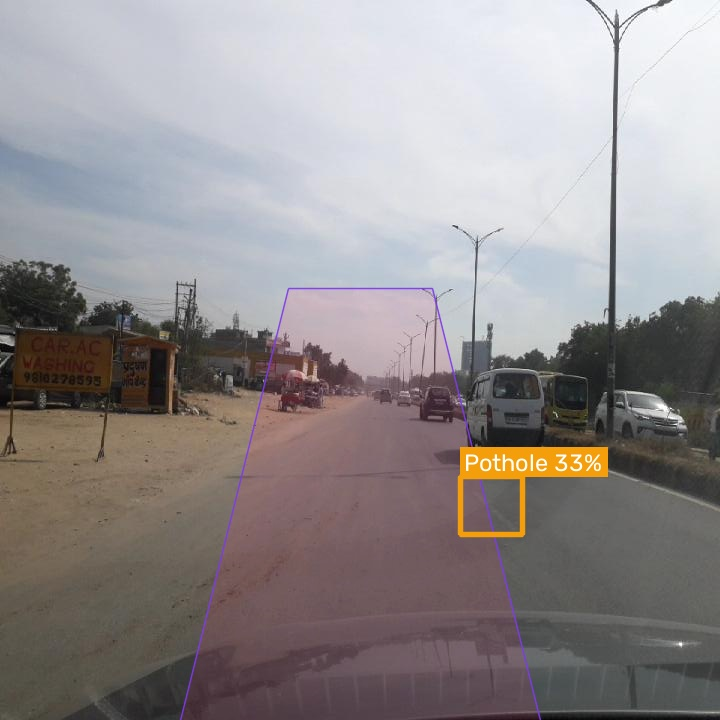

# AniRoute — real-time road-hazard detection for crop-aware delivery

**CSST 106 Final Project · Real-World Perception and Computer Vision System**
Field: agriculture and transportation · CV tasks: object detection, real-time video detection.
A phone or dashcam on a farm-produce vehicle detects road damage with a YOLO11 model, pretrained on COCO and
fine-tuned by us to find **potholes and cracks** (severe road damage). Obstruction
detection (a COCO-pretrained second model) is implemented but switched off: the project focuses on road damage.
Hazards seen in 2 of 3 frames alert the driver; confirmed hazards are geotagged and raise the road risk
of every route that passes them, weighted by how fragile the crop is, so the app can recommend a safer
route.

When standing water hides the pothole texture, a supplemental OpenCV check looks for a smooth reflection
inside a darker, horizontally elongated road depression before applying the same multi-frame confirmation.



## Quick start

Windows (PowerShell):

```powershell
powershell -ExecutionPolicy Bypass -File scripts/start.ps1
```

macOS / Linux / Git Bash:

```bash
bash scripts/start.sh
```

The first run creates `.venv`, installs CPU PyTorch, the backend and the frontend packages (≈300 MB), and
downloads the COCO model. Then it opens <http://127.0.0.1:5173> (API on <http://127.0.0.1:8000>).
Requirements: Python 3.10–3.12, Node 22.12+.

Manual start:

```bash
python -m pip install --index-url https://download.pytorch.org/whl/cpu torch torchvision
python -m pip install -r backend/requirements.txt
python -m uvicorn backend.main:app --port 8000          # from the repository root
cd frontend && npm ci && npm run dev
```

## What to look at

| Page | What it shows |
| --- | --- |
| **Plan → Active trip** | Live OSRM route options scored for the crop; during the trip the camera (or a recorded drive) is analysed in real time; confirm a hazard → routes re-scored |
| **Evaluation** | Metrics, confusion matrix, PR/F1 curves, optimisation table, CLAHE ablation, speed, error gallery, limitations — read from `ml/reports/` |
| **About** | Problem, objectives, beneficiaries, architecture, how the detector works, limits and privacy |

## Train and evaluate the road-surface model (Model A)

No labelling needed: the data is a seeded subset of RDD2022 (India, already labelled), downloaded from its
public Hugging Face mirror. Details in [`docs/DATASET.md`](docs/DATASET.md). Everything ran on a laptop CPU:

```bash
python ml/scripts/download_rdd2022.py --country India --train 1800 --valid 450 --test 450
python ml/scripts/prepare_dataset.py --source ml/data/raw/rdd2022_hf/data     --map pothole=pothole longitudinal_crack=severe_road_damage           transverse_crack=severe_road_damage alligator_crack=severe_road_damage
bash ml/run_cpu_pipeline.sh     # ~7 h: E0 + E1 training, pick best on val, test once, export, speed,
                                # demo video, slides; safe to re-run after a reboot (resumes)
cd frontend && npm run screenshots   # fresh screenshots (servers running)
```

1. `prepare_dataset.py` maps the classes and removes train/test near-duplicates;
2. `train.py` trains E0 (baseline, 20 epochs) and E1 (40 epochs, early stopping) from COCO weights;
3. `evaluate.py` picks the better run on the validation split and evaluates it once on the test split;
4. `export.py` writes ONNX/OpenVINO copies. The API selects ONNX on Apple Silicon and otherwise prefers
   OpenVINO, with ONNX and PyTorch fallbacks.

With a GPU, `ml/notebooks/train_colab.ipynb` and the presets E2–E4/E7 in `train.py` extend the series.

## Reproduce every number

```bash
python ml/evaluate.py test        --data ml/data/aniroute/data.yaml --run-dir ml/runs/<selected>
python ml/evaluate.py compare     --runs ml/runs/E0 ml/runs/E1
python ml/evaluate.py latency
python ml/evaluate.py smoothing   --video backend/samples/demo_drive.webm
python ml/scripts/preprocess_demo.py
python ml/scripts/annotate_samples.py   # annotated detections for the slides
```

## Tests

```bash
python -m pytest -q backend/tests ml/tests          # API, vision service, metrics (no weights needed)
cd frontend && npm run typecheck && npm test && npm run build
npm run test:integration                            # against a running backend
```

## Project structure

```
backend/
  main.py              FastAPI app: routing, hazard scanning/confirmation, route re-scoring
  hazard_risk.py       confirmed hazards → route road-risk (75 m, severity × crop sensitivity)
  vision/              preprocessing, YOLO wrapper, two-model integration, smoothing, API router
  models/              aniroute-hazards-v1.pt (Model A, after training); yolo11n.pt auto-downloaded
  samples/             sample images and the recorded drive for the trip
ml/
  run_cpu_pipeline.sh           the full CPU run used for the submitted results
  notebooks/train_colab.ipynb   optional GPU training on Colab
  scripts/                      download_rdd2022, prepare_dataset, preprocess_demo, make_demo_video
  train.py · evaluate.py · export.py
  evaluation/                   metrics (unit-tested), dataset reader, plots
  reports/                      every metric and figure used by the app, docs and slides
frontend/src/
  pages/               PlanPage, ActiveTripPage, EvaluationPage, AboutPage
  components/vision/   DetectionOverlay, ConfusionMatrix
docs/                  problem, system overview, dataset, model card, evaluation, demo script, defense Q&A
presentation/          build_deck.py → AniRoute_CSST106.pptx, screenshots/
```

## Documentation

- [Manual test walkthrough](docs/MANUAL_TEST_WALKTHROUGH.md) — verify startup, routing, recorded-drive detection, evaluation, and course coverage
- [Problem and objectives](docs/PROBLEM_AND_OBJECTIVES.md) — real-world problem, sources, beneficiaries
- [System overview](docs/SYSTEM_OVERVIEW.md) — architecture and detection flowchart
- [Dataset](docs/DATASET.md) — source, licence, counts, how to reproduce
- [Model card](docs/MODEL_CARD.md) — how YOLO works, pretrained vs fine-tuned, thresholds, limitations
- [Evaluation](docs/EVALUATION.md) — protocol, metrics explained, results
- [Demo script](docs/DEMO_SCRIPT.md) · [Defense Q&A](docs/DEFENSE_QA.md) · [Presentation outline](docs/PRESENTATION_OUTLINE.md)

## Configuration

Backend environment variables (see `backend/.env.example`): `ANIROUTE_MODEL_PATH`,
`ANIROUTE_OBSTRUCTION_MODEL_PATH`, `ANIROUTE_MODEL_FORMAT` (`auto`/`pt`/`onnx`/`openvino`),
`ANIROUTE_CONF_THRESHOLD`, `ANIROUTE_ROI_*`, `ANIROUTE_SMOOTHING_*`, `ANIROUTE_ROUTING_URL`, `CORS_ORIGINS`.

All data is live: road geometry and ETA come from OSRM, place search from Nominatim (OpenStreetMap), and
road risk from camera-confirmed hazards. Route planning and map tiles therefore need an internet connection;
the Evaluation page works offline. Weather and flood feeds are not connected.

## Credits and licences

Ultralytics YOLO (AGPL-3.0) · OpenCV · FastAPI · Vue · MapLibre · © OpenStreetMap contributors, © CARTO ·
OSRM · datasets as listed in `docs/DATASET.md` (RDD2022: Arya et al., arXiv:2209.08538).
