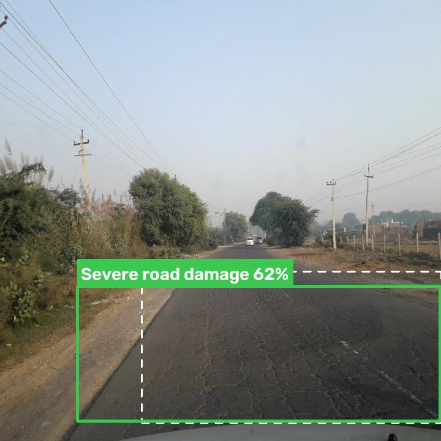

# AniRoute — real-time road-hazard detection for crop-aware delivery

**CSST 106 Final Project · Real-World Perception and Computer Vision System**
Field: agriculture and transportation · CV tasks: object detection, real-time video detection.
A phone or dashcam on a farm-produce vehicle detects road damage with a YOLO11 model trained by us on
labelled road images, for two classes: **cracks** (shown in the app as "severe road damage") and
**potholes**. Crack detection works well (86% of crack alerts are real on held-out test images). The
pothole class is unreliable: our own audit found that the public dataset mirror we used labelled mostly
faded lane paint as "pothole" (details: [`ml/reports/pothole_label_audit.md`](ml/reports/pothole_label_audit.md)).
A rule-based OpenCV check for water-filled potholes is **on** (`ANIROUTE_ENABLE_WATER_POTHOLE_DETECTOR`).
It is experimental, with no labelled test set yet. Obstruction detection (a second model) is implemented
but switched off. Hazards seen in 2 of 3 frames alert the driver. Confirmed hazards are geotagged and
raise the road risk of every route that passes them, weighted by how fragile the crop is, so the app can
recommend a safer route.



## Setup: from a fresh clone to a phone

### 1. What you need

| | Version | Check with |
| --- | --- | --- |
| Windows 10/11 (macOS or Linux also work) | | |
| [Git](https://git-scm.com/downloads) | any recent | `git --version` |
| [Python](https://www.python.org/downloads/) | **3.10–3.12** (3.12 recommended; tick "Add python.exe to PATH") | `python --version` |
| [Node.js](https://nodejs.org/) | **22.12 or newer** (the LTS installer is fine) | `node --version` |

You also need an internet connection (route planning, place search and map tiles are online services) and
about 3 GB of free disk space. No GPU is needed, and you don't have to train anything: the trained model
is in the repository.

### 2. Get the code

```bash
git clone https://github.com/Nezraaaa/AniRoute.git
cd AniRoute
git switch feat/cv-defense
```

### 3. First start on the laptop

Windows (PowerShell, from the `AniRoute` folder):

```powershell
powershell -ExecutionPolicy Bypass -File scripts/start.ps1
```

macOS / Linux / Git Bash: `bash scripts/start.sh`

The first run takes 5–15 minutes. It:
1. creates a Python environment in `.venv`;
2. installs CPU-only PyTorch and the backend packages (about 300 MB);
3. installs the web app's packages;
4. starts the API on <http://127.0.0.1:8000> and the web app on <http://127.0.0.1:5173>, and opens the browser.

Later starts take a few seconds. When the page opens, the badge in the header should say the detector
is online; it can show "starting" for a few seconds first.

<details>
<summary>Manual setup, if the script doesn't work</summary>

```bash
python -m venv .venv
# Windows: .venv\Scripts\activate      macOS/Linux: source .venv/bin/activate
python -m pip install --index-url https://download.pytorch.org/whl/cpu torch torchvision
python -m pip install -r backend/requirements.txt
python -m uvicorn backend.main:app --port 8000          # terminal 1, from the repository root
cd frontend && npm ci && cp .env.example .env && npm run dev   # terminal 2
```
</details>

### 4. Try it on the laptop

1. **Plan:** enter a crop (e.g. Tomatoes, 250 kg), a vehicle, a pickup point and a delivery point, then
   click **Find routes**. You get three route options (Recommended, Fastest and Safest) on the map.
2. **Use this route**, then on the trip page click **Analyse recorded drive**. Detections appear on the
   road camera, and an alert pops up once a hazard is seen in 2 of 3 frames.
3. **Confirm** the alert: the hazard is pinned on the map and the routes are re-scored.

To stop, close the script window or press **Ctrl+C**.

### 5. Use it on a phone over Wi-Fi

The laptop runs AniRoute, and the phone opens it in its browser. Phones only allow the camera and GPS on
secure pages, so phone mode is served over **https** with a certificate made on the laptop.

1. **Same network.** Connect the phone to the same Wi-Fi as the laptop. Venue or school Wi-Fi often blocks
   devices from reaching each other; if so, turn on the laptop's **Mobile hotspot** (Windows: Settings →
   Network & internet → Mobile hotspot) and connect the phone to it.
2. **Allow the port (Windows, once per laptop).** Open **PowerShell as administrator** and run:

   ```powershell
   New-NetFirewallRule -DisplayName 'AniRoute web app (5173)' -Direction Inbound -Protocol TCP -LocalPort 5173 -Action Allow -Profile Any
   ```

3. **Start phone mode.** Stop the laptop mode first (both use port 5173), then:

   ```powershell
   powershell -ExecutionPolicy Bypass -File scripts/start-lan.ps1
   ```

   macOS / Linux: `bash scripts/start-lan.sh`. The script prints an address such as
   `https://192.168.1.127:5173`. The number changes between networks, so use the one it prints; on
   Windows, `ipconfig` also shows it ("IPv4 Address").
4. **Open it on the phone** and accept the certificate warning once:
   - **iPhone (Safari):** Show Details → visit this website → Visit Website.
   - **Android (Chrome):** Advanced → Proceed to 192.168.x.x (unsafe).

   The connection is still encrypted; the warning only means the certificate isn't from a public
   authority.
5. **Allow camera and location** when the trip page asks. Then plan a trip, start it and use **Use live
   camera**, or **Analyse recorded drive**.

The laptop must stay on and running the script for the whole session. More detail:
[`docs/PHONE_ON_WIFI.md`](docs/PHONE_ON_WIFI.md).

### 6. If something goes wrong

| Problem | Fix |
| --- | --- |
| `python` or `npm` is not recognised | Reinstall Python/Node with "Add to PATH" ticked, then open a new terminal. |
| "running scripts is disabled" | Start it exactly as shown: `powershell -ExecutionPolicy Bypass -File …`. |
| Port 8000 or 5173 is already in use | Another copy is still running: close its window, or restart the laptop. |
| Header says "backend offline" | The API window closed or crashed: start the script again and read its messages. |
| No routes / place search finds nothing | Check the internet connection: routing and search are online services. |
| Phone can't open the page | Same Wi-Fi? Firewall rule added? Script still running? Try the laptop's hotspot. |
| Phone camera or GPS doesn't start | Use the `https://` address, accept the certificate, and allow camera/location in the browser's site settings. |

## What to look at

| Page | What it shows |
| --- | --- |
| **Plan → Active trip** | Live OSRM route options scored for the crop; during the trip the camera (or a recorded drive) is analysed in real time; confirm a hazard → routes re-scored |
| **Evaluation** | Metrics, confusion matrix, PR/F1 curves, optimisation table, CLAHE ablation, speed, error gallery, limitations — read from `ml/reports/` |
| **About** | Problem, objectives, beneficiaries, architecture, how the detector works, limits and privacy |

## Train and evaluate the road-surface model (Model A)

No labelling needed: the data is a seeded subset of RDD2022 (India, already labelled), downloaded from its
public Hugging Face mirror. Details in [`docs/DATASET.md`](docs/DATASET.md). Everything ran on a laptop CPU:

```bash
python ml/scripts/download_rdd2022.py --country India --train 1800 --valid 450 --test 450
python ml/scripts/prepare_dataset.py --source ml/data/raw/rdd2022_hf/data     --map pothole=pothole longitudinal_crack=severe_road_damage           transverse_crack=severe_road_damage alligator_crack=severe_road_damage
bash ml/run_cpu_pipeline.sh     # ~7 h: E0 + E1 training, pick best on val, test once, export, speed,
                                # demo video, slides; safe to re-run after a reboot (resumes)
cd frontend && npm run screenshots   # fresh screenshots (servers running)
```

1. `prepare_dataset.py` maps the classes and removes train/test near-duplicates;
2. `train.py` trains E0 (baseline, 20 epochs) and E1 (40 epochs, early stopping) from COCO weights;
3. `evaluate.py` picks the better run on the validation split and evaluates it once on the test split;
4. `export.py` writes ONNX/OpenVINO copies. The API selects ONNX on Apple Silicon and otherwise prefers
   OpenVINO, with ONNX and PyTorch fallbacks.

With a GPU, `ml/notebooks/train_colab.ipynb` and the presets E2–E4/E7 in `train.py` extend the series.

## Reproduce every number

```bash
python ml/evaluate.py test        --data ml/data/aniroute/data.yaml --run-dir ml/runs/<selected>
python ml/evaluate.py compare     --runs ml/runs/E0 ml/runs/E1
python ml/evaluate.py latency
python ml/evaluate.py smoothing   --video backend/samples/demo_drive.webm
python ml/scripts/preprocess_demo.py
python ml/scripts/annotate_samples.py   # annotated detections for the slides
```

## Tests

```bash
python -m pytest -q backend/tests ml/tests          # API, vision service, metrics (no weights needed)
cd frontend && npm run typecheck && npm test && npm run build
npm run test:integration                            # against a running backend
```

## Project structure

```
backend/
  main.py              FastAPI app: routing, hazard scanning/confirmation, route re-scoring
  hazard_risk.py       confirmed hazards → route road-risk (75 m, severity × crop sensitivity)
  vision/              preprocessing, YOLO wrapper, two-model integration, smoothing, API router
  models/              aniroute-hazards-v1.pt (our trained model) and its ONNX/OpenVINO exports
  samples/             sample images and the recorded drive for the trip
ml/
  run_cpu_pipeline.sh           the full CPU run used for the submitted results
  notebooks/train_colab.ipynb   optional GPU training on Colab
  scripts/                      download_rdd2022, prepare_dataset, preprocess_demo, make_demo_video
  train.py · evaluate.py · export.py
  evaluation/                   metrics (unit-tested), dataset reader, plots
  reports/                      every metric and figure used by the app, docs and slides
frontend/src/
  pages/               PlanPage, ActiveTripPage, EvaluationPage, AboutPage
  components/vision/   DetectionOverlay, ConfusionMatrix
docs/                  problem, system overview, dataset, model card, evaluation, demo script, defense Q&A
presentation/          build_deck.py → AniRoute_CSST106.pptx, screenshots/
```

## Documentation

- [Manual test walkthrough](docs/MANUAL_TEST_WALKTHROUGH.md) — verify startup, routing, recorded-drive detection, evaluation, and course coverage
- [Problem and objectives](docs/PROBLEM_AND_OBJECTIVES.md) — real-world problem, sources, beneficiaries
- [System overview](docs/SYSTEM_OVERVIEW.md) — architecture and detection flowchart
- [Dataset](docs/DATASET.md) — source, licence, counts, how to reproduce
- [Model card](docs/MODEL_CARD.md) — how YOLO works, pretrained vs fine-tuned, thresholds, limitations
- [Evaluation](docs/EVALUATION.md) — protocol, metrics explained, results
- [Demo script](docs/DEMO_SCRIPT.md) · [Defense Q&A](docs/DEFENSE_QA.md) · [Presentation outline](docs/PRESENTATION_OUTLINE.md)

## Configuration

Backend environment variables (see `backend/.env.example`): `ANIROUTE_MODEL_PATH`,
`ANIROUTE_OBSTRUCTION_MODEL_PATH`, `ANIROUTE_MODEL_FORMAT` (`auto`/`pt`/`onnx`/`openvino`),
`ANIROUTE_CONF_THRESHOLD`, `ANIROUTE_ROI_*`, `ANIROUTE_SMOOTHING_*`, `ANIROUTE_ROUTING_URL`, `CORS_ORIGINS`.

All data is live: road geometry and ETA come from OSRM, place search from Nominatim (OpenStreetMap), and
road risk from camera-confirmed hazards. Route planning and map tiles therefore need an internet connection;
the Evaluation page works offline. Weather and flood feeds are not connected.

## Credits and licences

Ultralytics YOLO (AGPL-3.0) · OpenCV · FastAPI · Vue · MapLibre · © OpenStreetMap contributors, © CARTO ·
OSRM · datasets as listed in `docs/DATASET.md` (RDD2022: Arya et al., arXiv:2209.08538).
