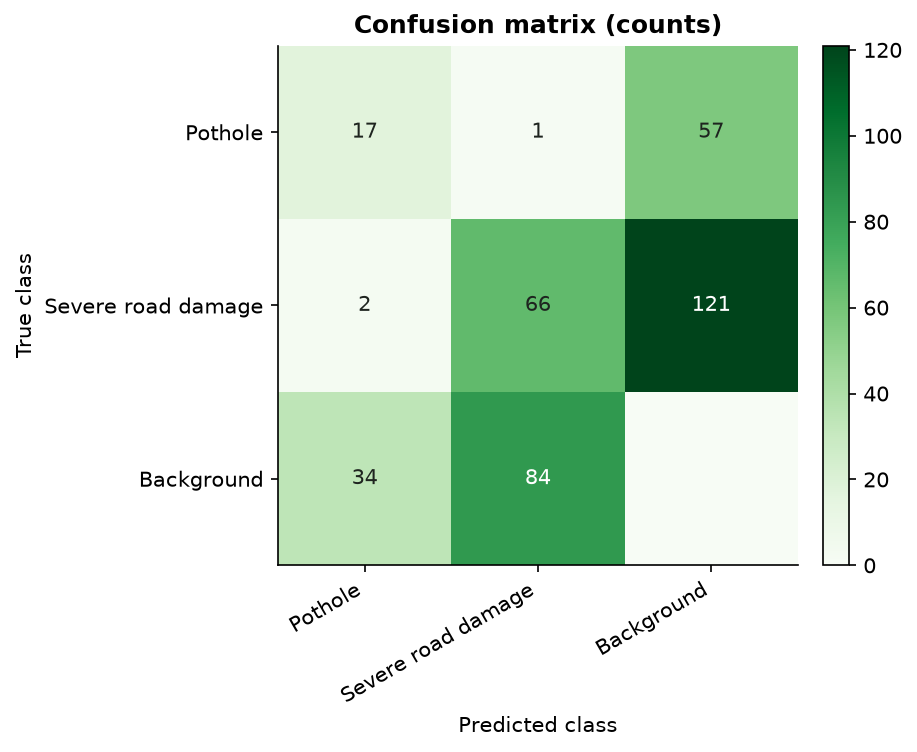
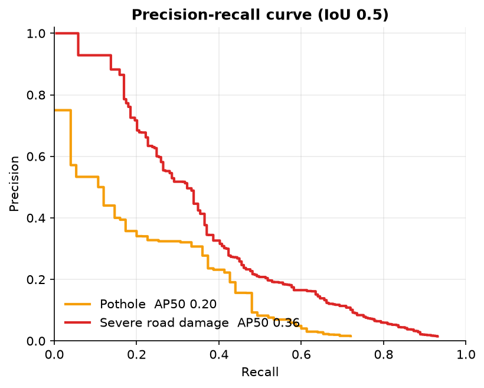

# Evaluation

All numbers come from `ml/evaluate.py`, which runs the **app's own preprocessing** (not a separate
pipeline) on images the model never trained on and writes everything to `ml/reports/`. The in-app
**Evaluation** page reads the same files. Re-run any time:

```bash
python ml/evaluate.py test      --data ml/data/aniroute/data.yaml --run-dir ml/runs/<selected>
python ml/evaluate.py compare   --runs ml/runs/E0 ml/runs/E1 ml/runs/E2 ml/runs/E3 ml/runs/E4
python ml/evaluate.py latency
python ml/evaluate.py obstruction --data ml/data/obstruction_test/data.yaml
python ml/evaluate.py smoothing --video backend/samples/demo_drive.webm
python ml/scripts/preprocess_demo.py
```

## Protocol (how we avoid fooling ourselves)

1. Train on **train**; choose the best experiment and the confidence threshold on **val**.
2. Report **test** once with those choices fixed.
3. Near-duplicate images are removed from val/test before training (`prepare_dataset.py`).
4. The optional `test_local` split (Philippine photos) is never trained on.

## Metrics in one sentence each

| Metric | Meaning |
| --- | --- |
| IoU | Overlap of a predicted box and a true box (intersection ÷ union); ≥ 0.5 counts as a match |
| Precision | Of the hazards the system reported, the share that were real |
| Recall | Of the real hazards, the share the system found |
| F1 | Harmonic mean of precision and recall at the operating threshold |
| AP / mAP@0.5 | Area under the precision-recall curve (101-point COCO method), averaged over classes, at IoU 0.5 |
| mAP@0.5:0.95 | Same, averaged over IoU thresholds 0.50, 0.55 … 0.95 (rewards tight boxes) |
| Confusion matrix | Rows = true class, columns = predicted class; background = missed object or false alarm |
| TP / FP / FN | Correct detections / false alarms / missed hazards |

Our implementation (`ml/evaluation/metrics.py`) is unit-tested against hand-computed cases
(`ml/tests/test_metrics.py`).

## Results

### Model A on the test split — _pending training_

| File | Content |
| --- | --- |
| `metrics.json` | overall and per-class P, R, F1, AP50, AP50-95, TP/FP/FN, operating threshold |
| `confusion_matrix.png`, `confusion_matrix_normalized.png` | confusion matrix |
| `pr_curve.png`, `f1_confidence_curve.png`, `training_curves.png` | curves |




### Optimisation series — _pending training_

`optimization_table.md` and `optimization_chart.png` (E0 → E7, validation split, with CPU speed).
E5 = confidence threshold tuned at max F1; E6 = CLAHE off vs auto, both on the selected run.

### Preprocessing before vs after — _pending training_

`ablation.json`, `ablation_bar.png` (mAP and F1 with CLAHE off / auto / on, overall and on dark images)
and `preprocessing_before_after.png`. Report the result as measured — if CLAHE does not help overall but
helps on dark images, say exactly that.

### Speed on the presentation laptop — **measured**

`latency.json` and `speed_chart.png` hold mean and 95th-percentile time per frame for each model, runtime
(PyTorch / ONNX / OpenVINO) and input size, plus the end-to-end system time (preprocessing + both models
+ merging). Model B has already been measured on the development laptop (AMD Ryzen, CPU only): OpenVINO
was the fastest runtime. **Re-run `python ml/evaluate.py latency` on the laptop you present with** —
timings vary between machines and between runs.


### Model B and smoothing — _pending test data / demo video_

`model_b.json` (with vs without the driving-corridor rule) and `smoothing.json` (alerts per minute with
vs without 2-of-3 voting). For smoothing, watch the demo video and set each alert's `verdict` to `true` or
`false` to report false alarms per minute.

### Error analysis — _pending training_

`error_gallery/` (false alarms, missed hazards, wrong class — with captions) and `error_analysis.md`
(miss rate by object size and by lighting, false alarms by class). Add 3–5 sentences of interpretation
below once the gallery exists.

> _Team interpretation:_ …
