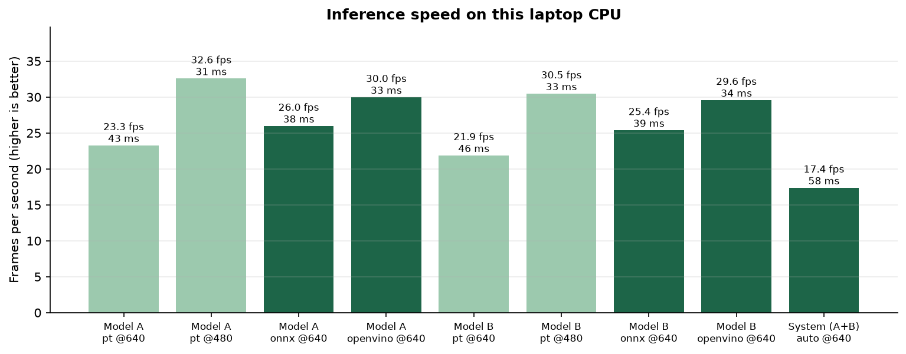

# Evaluation

All numbers come from `ml/evaluate.py`, which runs the **app's own preprocessing** (not a separate
pipeline) on images the model never trained on and writes everything to `ml/reports/`. The in-app
**Evaluation** page reads the same files. Re-run any time:

```bash
python ml/evaluate.py test      --data ml/data/aniroute/data.yaml --run-dir ml/runs/<selected>
python ml/evaluate.py compare   --runs ml/runs/E0 ml/runs/E1
python ml/evaluate.py latency
python ml/evaluate.py smoothing --video backend/samples/demo_drive.webm
python ml/scripts/preprocess_demo.py
```

## Protocol (how we avoid fooling ourselves)

1. Train on **train**; choose the best experiment and the confidence threshold on **val**.
2. Report **test** once with those choices fixed.
3. Near-duplicate images are removed from val/test before training (`prepare_dataset.py`).
4. The selected model (E1), threshold (0.145) and preprocessing (CLAHE off) were all fixed on validation
   before the single test run.

## Metrics in one sentence each

| Metric | Meaning |
| --- | --- |
| IoU | Overlap of a predicted box and a true box (intersection ÷ union); ≥ 0.5 counts as a match |
| Precision | Of the hazards the system reported, the share that were real |
| Recall | Of the real hazards, the share the system found |
| F1 | Harmonic mean of precision and recall at the operating threshold |
| AP / mAP@0.5 | Area under the precision-recall curve (101-point COCO method), averaged over classes, at IoU 0.5 |
| mAP@0.5:0.95 | Same, averaged over IoU thresholds 0.50, 0.55 … 0.95 (rewards tight boxes) |
| Confusion matrix | Rows = true class, columns = predicted class; background = missed object or false alarm |
| TP / FP / FN | Correct detections / false alarms / missed hazards |

Our implementation (`ml/evaluation/metrics.py`) is unit-tested against hand-computed cases
(`ml/tests/test_metrics.py`).

## Results

### Model A on the test split (444 held-out images, 264 labelled objects)

Selected run **E1**, confidence **0.145** (max F1 on validation), CLAHE off, IoU 0.5.

| Class | Objects | AP@0.5 | AP@0.5:0.95 | Precision | Recall | F1 | TP / FP / FN |
| --- | ---: | ---: | ---: | ---: | ---: | ---: | --- |
| pothole | 75 | 0.197 | 0.083 | 0.32 | 0.23 | 0.27 | 17 / 36 / 58 |
| severe_road_damage | 189 | 0.358 | 0.162 | 0.44 | 0.35 | 0.39 | 66 / 85 / 123 |
| **overall** | **264** | **0.278** | **0.122** | **0.41** | **0.31** | **0.35** | 83 / 121 / 181 |

Confusion matrix (rows = true, columns = predicted): the two classes are almost never confused with each
other (3 of 264); nearly all errors are against *background*: missed objects (181) or false alarms (121).


**How good is this?** Modest, and expected for the setup: a nano model (2.6 M parameters), 1,800 training
images, 40 epochs on a laptop CPU. RDD2022 is a hard benchmark: crack boxes are long, thin and labelled
inconsistently (see the error analysis below). The test score is
close to the validation score (0.339), so the model is not overfitting the validation choices.

### Optimisation series (validation split, 448 images)

| Step | Change | mAP@0.5 | mAP@0.5:0.95 | F1 | CPU ms |
| --- | --- | ---: | ---: | ---: | ---: |
| E0 | Baseline: COCO-pretrained YOLO11n, 20 epochs | 0.289 | 0.117 | 0.364 | 45 |
| **E1 ★** | Longer training: 40 epochs, early stopping | **0.334** | **0.137** | 0.427 | 46 |
| E5 | Confidence threshold 0.25 → 0.145 (max F1) | 0.334 | 0.137 | 0.378 → **0.427** | 46 |
| E6 | CLAHE auto → **off** | 0.334 → **0.339** | – | 0.427 → 0.430 | 46 |

Longer training gave the biggest gain (+16% relative mAP@0.5); tuning the threshold raised F1 by 13%
at no cost. Full table: `ml/reports/optimization_table.md`; chart: `optimization_chart.png`.

### Preprocessing before vs after (CLAHE ablation, test split)

| CLAHE | mAP@0.5 all | F1 all | mAP@0.5 dark images (13) |
| --- | ---: | ---: | ---: |
| **off (app default)** | **0.278** | **0.355** | **0.435** |
| auto (dark/low-contrast only) | 0.265 | 0.348 | 0.284 |
| always on | 0.196 | 0.252 | 0.284 |

CLAHE made the model **worse**, even on dark images. Our explanation: the model was trained on
un-enhanced images, so CLAHE shifts the input away from what it learned, and it amplifies asphalt texture
that then looks like cracks. The decision was made on validation (E6) and confirmed on test, so the app
keeps CLAHE **off** by default and offers it as an option in the Vision Lab. The dark subset is small (13
images), so that column is indicative only. `ablation_bar.png`, `preprocessing_before_after.png`.

### Speed on the presentation laptop (AMD Ryzen, CPU only)

| Model | PyTorch 640 | ONNX 640 | OpenVINO 640 |
| --- | ---: | ---: | ---: |
| Model A (road damage) | 42.8 ms | 38.5 ms | **33.3 ms** |
| Model B (COCO obstructions) | 45.7 ms | 39.4 ms | **33.7 ms** |

End to end (preprocessing + both models + merging, auto-selected OpenVINO): **57.6 ms per frame ≈ 17 FPS**
(95th percentile 67 ms). The app only needs 2 frames per second during a trip, so there is ample headroom.
Re-run `python ml/evaluate.py latency` on the laptop you present with. `latency.json`, `speed_chart.png`.



### Temporal smoothing (36 s demo drive, 72 analysed frames)

| | Alerts | Alerts per minute |
| --- | ---: | ---: |
| Every frame with a detection | 39 | 65 |
| **2-of-3 frames + 20 s cooldown** | **4** | **6.7** |

Smoothing cut alerts by 90%, the difference between an app a driver ignores and one they can use.
`smoothing.json` lists the 4 remaining alerts; watch the video and mark each `true`/`false` to report false
alarms per minute.

### Model B (obstructions)

Not measured: we did not label an obstruction test set. Model B is the unchanged COCO model, so its
accuracy is the published COCO accuracy; our contribution is the driving-corridor rule, demonstrated on
the sample street image in the Vision Lab. This is a stated limitation.

### Error analysis

`error_gallery/` (false alarms, misses, wrong class, with captions) and `error_analysis.md`.

| Object size (share of image) | Objects | Missed |
| --- | ---: | ---: |
| small (< 0.5%) | 16 | 88% |
| medium (0.5–5%) | 148 | 80% |
| large (> 5%) | 100 | 45% |

> **Interpretation.** Most errors are not the model failing to see damage but a mismatch with how it was
> labelled. On cracked road, the model often draws one large box where the annotator drew several small
> ones (or the reverse); at IoU 0.5 that single detection counts as one false alarm *and* several misses.
> Many "false alarms" are real-looking damage that was simply not labelled: broken road edges, gravel
> shoulders, patched asphalt. Genuine misses are mostly small or distant potholes (88% of small objects
> missed), which a 640-pixel nano model resolves poorly. The fixes are more training images, a larger
> model or higher input resolution (presets E2–E3, need a GPU), and labels from Philippine roads.
