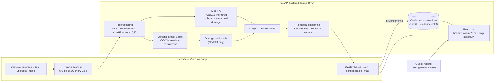
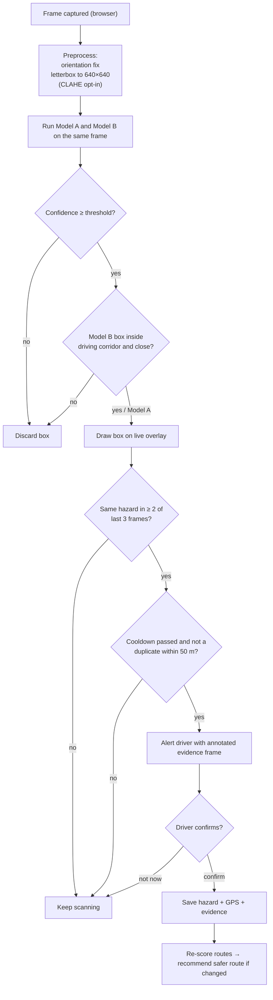

# System overview

## Architecture

## Detection flowchart (one camera frame)

## Components

| Layer | Files | Responsibility |
| --- | --- | --- |
| Preprocessing | `backend/vision/preprocess.py` | Decode, EXIF orientation, CLAHE, letterbox; shared with evaluation |
| Detectors | `backend/vision/detector.py` | Lazy YOLO loading; uses ONNX on Apple Silicon, otherwise OpenVINO → ONNX → PyTorch |
| Integration | `backend/vision/ensemble.py` | Runs Model A, the optional Model B, and the optional water-filled-pothole check (off by default); maps and merges results |
| Smoothing | `backend/vision/smoothing.py` | 2-of-3 voting, cooldown, 50 m dedupe |
| API | `backend/vision/router.py`, `backend/main.py` | `/api/vision/*`, `/api/model/*`, `/api/hazards/*`, `/api/routes/*` |
| Route risk | `backend/hazard_risk.py` | Point-to-route distance, severity weights, crop multiplier |
| Web app | `frontend/src/pages/*`, `components/vision/*` | Plan, Active Trip scanning, Evaluation, About |
| Training & evaluation | `ml/` | Dataset preparation, training presets, metrics, figures |

## API summary

| Method | Path | Purpose |
| --- | --- | --- |
| GET | `/api/health` | Status, whether detection is live, supported hazards |
| GET | `/api/model/info` | Models, thresholds, corridor, smoothing settings |
| GET | `/api/model/metrics` | Every report in `ml/reports/` (JSON + figure URLs) |
| POST | `/api/vision/detect` | Upload an image → boxes, annotated image, preprocessing stages |
| POST | `/api/vision/detect-frame` | Detect on a video/webcam frame (data URL) |
| POST | `/api/hazards/scanning/start` · `/stop` | Begin/end trip scanning (resets smoothing) |
| POST | `/api/hazards/scan-frame` | Trip frame → overlay boxes + smoothed alert + evidence |
| POST | `/api/hazards/confirm` | Save a confirmed hazard (GPS, confidence, evidence) |
| POST | `/api/routes/calculate` · `/recalculate` | OSRM routes scored with confirmed hazards |
| GET | `/api/samples`, `/samples/*`, `/reports/*` | Sample images, recorded drive and report figures |

## Data flow and privacy

Frames are processed in memory and discarded. Only the evidence frame of a hazard the driver confirms is
written to `backend/data/evidence/`, with its GPS position, in `backend/data/hazard_observations.jsonl`
(both git-ignored).
